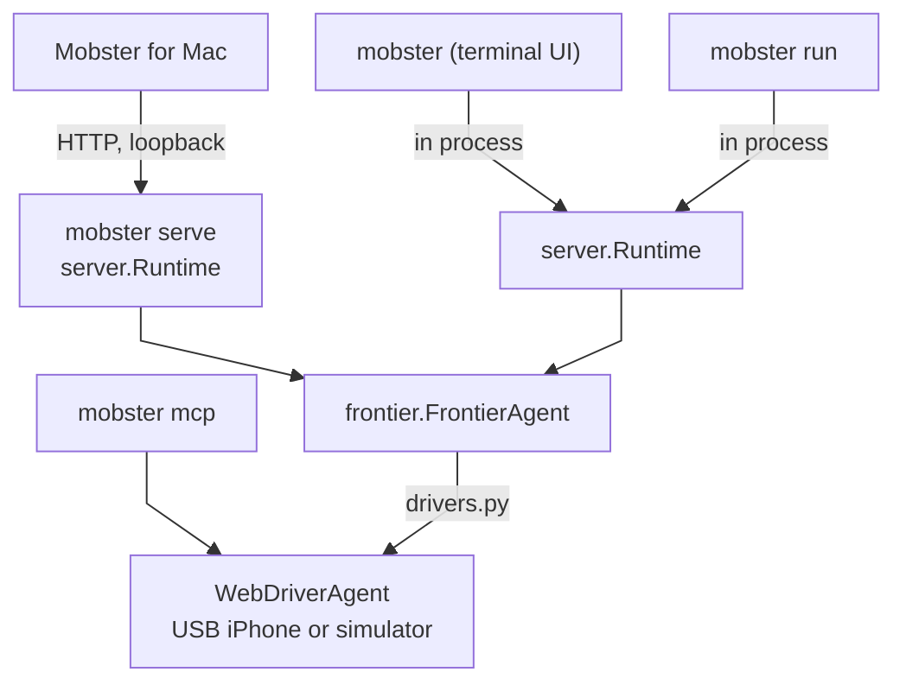

The full engineering notes, with every guard and the measurements behind them, are in [mobile_agent/docs/architecture.md](https://github.com/RadishSoftware/mobster/blob/main/mobile_agent/docs/architecture.md).

## The idea

A phone screen is built from labelled controls: buttons, cells, fields and switches, arranged in a tree. VoiceOver reads that tree aloud. Mobster reads the same tree through WebDriverAgent, and uses it with a screenshot to choose its next action. Mobster checks each step's decision before it sends anything to the phone.

Mobster's agent also sends the model a small screenshot when the model supports images, and can tap an unlabelled control by its position. Those taps pass [additional approval checks](/safety#when-mobster-asks). An app that exposes few labelled controls is harder to navigate and cannot support tree assertions for content it never exposes.

## One task, step by step

```text
your task ─▶ task contract: read, write, commit, report, forbid
                 │
                 ▼
          ┌─ observe: the accessibility tree and a small screenshot, settled ◀─┐
          │                                                                    │
          ▼                                                                    │
       decide: a saved program's next step, or the model's next 1 to 6 actions │
          │                                                                    │
          ▼                                                                    │
       verify: allowed apps, unrequested acts, the contract's commit check,    │
               your approval, a fresh read of the screen                       │
          │                                                                    │
          ▼                                                                    │
       act: send it, record the outcome ───────────────────────────────────────┘
          │  when the model says the task is done
          ▼
       DONE gate: every contract item has its receipt, then report
```

Mobster's agent is `FrontierAgent` in `frontier/`. `engines.py` builds it with its model, reasoning and limits (`SMART_CONFIG`), and `server.Runtime` runs it.

1. **Contract.** While the first screen is read, one text-only model call compiles your task into typed items (`contract.py`): READ a source, WRITE a value, COMMIT an act other people see or that spends, REPORT a detail, FORBID an act the task rules out.
2. **Observe.** The WDA driver (`drivers.py`, its reads in `wda/observe.py`) reads the tree and turns it into a `Snapshot` of elements with labels, roles, positions and values (`state.py`). It rebuilds what is visible from geometry, including what bars, keyboards and alerts cover. A step starts only once the screen has stopped changing, on the tree and, when a video stream is attached, on its pixels (`wda/frame_clock.py`).
3. **Decide.** The model gets the task, the contract, the plan and notes it keeps across steps and apps, the elements by short ids (`e1`, `e2`) and a small screenshot. It returns 1 to 6 chained actions (tap, long press, type, scroll, dismiss, open an app, read a list, wait, done) or a visible spot in the screenshot when no listed element names the control. A saved program that matches the task supplies its steps with no model call (`learned/programs.py`).
4. **Verify.** Before Mobster sends anything, the action passes these checks. Only apps on the task's list open. Mobster refuses a tap on a control whose label names an act the task doesn't ask for ("Delete" when you asked to archive), and tells the model why (`task_policy.requested_by`). A commit ("Send", "Pay \$42.00") passes only when the contract declares it (`contract.py`), and asks for your approval when your settings say so. A read taken while the model thinks replaces a screen that has since changed, and Mobster finds each target again by its label.
5. **Act.** The driver taps the element's coordinates (`wda/gestures.py`) or types into the field (`wda/text.py`). A chain stops at the first action whose target is missing or that changes nothing, and the model sees the new screen. The runtime writes each decision to the journal before its actions are sent (`journal.py`). An action whose outcome is unknown is never sent again blind: Mobster reads the screen first.
6. **Finish.** When the model says the task is done, the DONE gate in `contract.py` checks that every item has its receipt: a sent message in a non-editable row, a confirmation row for an order, a written value read back in its app, a reported value seen on a screen. A missing receipt reopens its item. The result says how the run ended and which items are unproven.

## Three front ends, one runtime



One `server.Runtime` admits one task per phone, journals every event, holds approvals, applies Ask before acting, and stops at safe points.

- **The terminal UI** (`tui/`) runs `server.Runtime` in its own process. A task is `Runtime.create`, its events are the run's event list, an approval is `Run.request_approval` answered with `Run.answer_approval` (`run.py`), and Stop is `Runtime.stop_run`. The UI only draws. `tui/session.py` is the thin layer between them and imports no UI library. `narrate.py` turns agent events into readable steps for both the UI and `mobster run`.
- **`mobster serve`** (`serve.py`, with its routes in `api_*.py`) puts the same `Runtime` behind a loopback HTTP API. The Mac app runs it as a bundled sidecar.
- **`mobster run`** (`smart_run.py`) runs one task through the same `Runtime` in its own process, and saves it in the terminal UI's journal. It asks for approvals on the terminal, and in a script the answer is no.

The Mac app, terminal UI and `mobster run` share run admission, device locks, limits, statuses and a durable task history.

## Where the code lives

| path | what it is |
| --- | --- |
| `mobile_agent/__main__.py`, `cli_parser.py` | the `mobster` command, and its parser and help |
| `mobile_agent/tui/` | the terminal UI: `app.py` (Textual), `session.py` (the engine), `render.py`, `demo_phone.py` |
| `mobile_agent/narrate.py`, `console.py` | events as readable steps, and `run`'s terminal output |
| `mobile_agent/doctor.py`, `history.py`, `terminal_image.py` | `doctor`, `history` and `screen` |
| `mobile_agent/server.py`, `runtime_*.py`, `api_*.py` | `Runtime` and the HTTP API |
| `mobile_agent/frontier/` | Mobster's agent, `FrontierAgent`: the observe, decide, verify, act loop |
| `mobile_agent/engines.py` | its model, reasoning and limits on your Claude or OpenAI key |
| `mobile_agent/smart_events.py`, `smart_result.py` | the events the UI and the Mac app render, and the result of a task |
| `mobile_agent/contract.py` | the task contract, the commit check and the DONE gate |
| `mobile_agent/task_policy.py` | the guard on controls that name an act the task doesn't ask for |
| `mobile_agent/drivers.py`, `wda/observe.py`, `wda/text.py`, `wda/gestures.py`, `state.py` | WebDriverAgent and the screen model |
| `mobile_agent/device_manager.py`, `wda/patches.py`, `supervised.py`, `mac_tools.py`, `setup_service.py` | building and supervising WDA on a USB iPhone, the edits made to it, and finding the Mac's tools |
| `mobile_agent/journal.py` | the crash-safe task journal and device locks |
| `mobile_agent/bench/`, `evals/` | MobsterBench-iOS, the iOSWorld runner and on-device measurement tools |
| `mobile_agent/tests/` | the test suite: no phone, simulator or key needed |
| `docs/` | these pages |
| `mobile_agent/docs/` | dated design notes |

The Python package is named `mobile_agent`, and the distribution and command are `mobster-cli` and `mobster`. The package keeps its name on purpose. The Mac app launches it as `python -m mobile_agent` in development and freezes it by that name in its sidecar. Private extensions load as `mobile_agent.private`. The benchmarks, tests and design notes all name it. A rename would touch every one of those, and users would see no difference.

## Extensions

`harness_api.hooks()` loads an optional `mobile_agent.private` package when one is installed. That package can add device targets, command-line flags and runtime subclasses through three of the engine's hooks. The public package has no such package, so those hooks stay empty and nothing changes.

## Data

A task sends its text, the screen's text and a small screenshot of each step to the model on your key. Provider keys saved through `mobster login <provider>` stay in the macOS Keychain. Keys supplied through your environment or env file stay there. Journals stay on your Mac. With [Mobster Remote](/remote) on, tasks and answers from allowed assistants pass through Mobster's relay without being stored there. Answers can include screen text. Shared results send their text; screens are included only if **Include screens** is on. Feedback can include a screenshot and optional diagnostics with the last task's steps. **Ask by link** uploads step content and any available screen encrypted on your Mac. See [Privacy and your data](/privacy). Mobster for Mac also talks to Mobster's account service for your plan ([Your Mobster account](/account)).

## Why the terminal UI uses Textual

The UI is built with [Textual](https://textual.textualize.io/). It is Python, so it runs the agent's runtime in the same process with no extra server. Its widgets cover the prompt, lists and popups, and its test pilot drives the real app headlessly, which is how the UI tests and these screenshots work. It opens full screen, which keeps the phone view, the approval card and the status line in place while the transcript scrolls. [textual-image](https://github.com/lnqs/textual-image) draws the screenshot in the phone view. It asks the terminal what it can draw before the UI starts, and only where the environment names a terminal that shows images. The transcript summary it prints on exit keeps a record in scrollback. `mobster run` is the line-by-line alternative. The UI's first frame appears in about 0.3 s. Textual loads only when the UI opens, so `mobster serve`, `mobster run` and the Mac app never load it.
