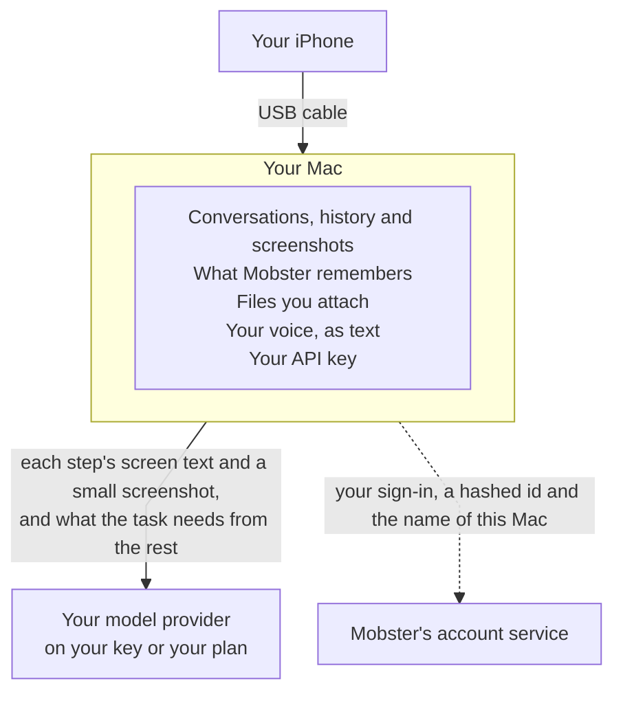

Mobster runs on your Mac. Your agent's commands go from your Mac to the phone over the cable. Unless you turn on [Mobster Remote](#mobster-remote), no server sits between an assistant and your phone. When Mobster's agent needs screen data, it sends it to the provider you choose, on your key or paid plan ([Models and keys](/models-and-keys)). [Shared results](#shared-links) send their text and, if **Include screens** is on, their screens. [Feedback](#feedback-you-send) can include a screenshot and diagnostics with the last task's steps. [Ask by link](#ask-by-link) uploads encrypted step content and any available screen. [Mobster Remote](#mobster-remote) carries tasks and answers, which can include screen text, through its relay without storing them there. Mobster for Mac signs in to a [Mobster account](#your-mobster-account) that holds your plan. Mobster's open-source engine, run from a source checkout, needs no account and sends nothing to us.

## What leaves your Mac

| What | Where it goes |
|---|---|
| Your agent's commands | From your Mac to the phone over USB. WebDriverAgent listens on the phone's loopback, reachable over USB only |
| Each step's screen text and a small screenshot | To your model provider, when Mobster's agent runs the task. On a Codex, Claude Code or Gemini CLI plan, your own copy of that agent sends them to its maker, under your plan |
| Your task, and what it needs from your conversation, memory and files | To your model provider, with the task: at most 3,000 characters of the conversation, at most 12 things Mobster remembers, and what the agent reads from attached files |
| What a tool returns to an agent you connect over MCP | To that agent, and from it to its own model |
| A task's result, when the task names a connector to send it to | To that connector only: your Google Sheet's script, your Notion database, a Discord channel, your own email address through Mail, or a webhook's address. A folder destination stays on your Mac ([Send results to other tools](/webhooks)) |
| What Mobster's agent passes a connector's tool, such as search words or an issue's title | To that connector's server (Notion, Linear, GitHub or one you added), when a task calls the tool. What it returns goes to your AI provider with the task ([Connectors](/connectors)) |
| The name of a GitHub repository you install a plugin from | To GitHub, which sends the repository's files to your Mac. Nothing of yours is uploaded |
| Your voice | Nowhere: it becomes text on your Mac, and nothing is recorded |
| What the iPhone shows and plays, when a step watches or listens (hearing is on unless `MOBSTER_LISTEN=off`) | Up to 12 frames, the text read from them on your Mac, and the words and other sounds heard, both recognized on your Mac, go to your model as one picture and a timeline, and stay in the task's history on your Mac. The recording never leaves your Mac, and Mobster deletes it when the step ends |
| A task from an assistant you connected through Mobster Remote, and its answer | Through Mobster's relay on Cloudflare, only while it passes, and only when you've turned Remote on |
| Your sign-in, a hashed id for the Mac and its name | To Mobster's account service at api.mobster.dev, from Mobster for Mac, when you sign in or move Mobster to another Mac, and every 10 minutes while it runs, to check your plan. Never a screen, a task or anything from the phone |
| Hashes of the Mac's serial number and of your iPhones' UDIDs, whether macOS runs in a virtual machine, the Mac's model, and a one-time DeviceCheck token from Apple | To Mobster's account service, for free trial eligibility only: when you start the trial, and with the plan check while your account has no plan (the DeviceCheck token only when you start it). The serial number and UDIDs never leave your Mac. See [What counts as one trial](/account#what-counts-as-one-trial) |
| Your Apple, Google or GitHub sign-in | Through your browser to Apple, Google or GitHub, and to Supabase, which runs Mobster's sign-in. Mobster never sees their passwords |
| Your email address, when you sign in with a code | To Supabase, which emails you the code and a sign-in link through Resend |

There are no analytics and no crash reporting.

## What stays on your Mac

- **Conversations, history and their screenshots**, in Mobster's journal, readable only by you. Deleting a conversation deletes its tasks and their screens.
- **What Mobster remembers**, in your words, in one file readable only by you. Mobster saves nothing until you choose **Remember**, and never remembers passwords, codes or card numbers. [Memory](/memory)
- **Files you attach.** A task sends only what it reads from them. Mobster deletes a file you add and no task uses within a day. [Files](/files)
- **Your notifications, if you use triggers.** Mobster reads them on this Mac, with Full Disk Access, to check them against your triggers. They never leave your Mac, except what a trigger sends where you told it to. Mobster keeps no notification's text. [Notification triggers](/triggers)
- **Your Messages, when you ask who's waiting on you.** Mobster reads `chat.db` and your Contacts on this Mac, read-only, and drafts replies with Apple's on-device model. No message text goes to a cloud model. The task keeps the names, the last message and the draft you see on the card. [Who's waiting on me](/waiting)
- **App X-ray's maps, when you map an app.** App X-ray reads the text of each screen it opens in the app you chose, with no model, and keeps a thumbnail of each screen. It masks keys, card numbers and codes it reads before it stores them. It writes `map.json`, `report.html` and the thumbnails to `xray/apps/<bundle ID>/<date>-<time>/` in Mobster's data folder, a folder only you can open, and sends nothing anywhere. The task keeps the screens' names and thumbnails like any task, and deleting the task deletes those; the folder stays until you delete it. [X-ray](/xray)
- **Network X-ray reports, when you record your phone.** [What it reads](#what-network-x-ray-reads) is below. The report stays in Mobster's data folder.
- **Your API key**, in the Mac app's env file or yours.

## What Network X-ray reads

Network X-ray records one iPhone's network traffic when you press **Network X-ray** or run `mobster xray network`. It uses Apple's packet capture service on the phone, which asks only that the phone trusts this Mac.

- **It reads** each connection's hostname (from a DNS answer, the server name in a TLS or QUIC handshake, or an HTTP Host header), the process that made it, its sizes and its times. Every name passes Mobster's secret filter before it reaches a report, a task or a log.
- **It never keeps** a page, a URL path, a header other than Host, a cookie, a body or an address. It decrypts nothing. Traffic on your local network counts as one total with no names.
- **The capture file** holds the first 256 bytes of each packet, more for DNS and the start of a TLS or QUIC handshake, which is where the hostname is. After the packet headers (54 to 94 bytes for TCP over IPv4 or IPv6), that leaves 160 to 200 bytes of payload a packet. Mobster deletes the file as soon as it has been read. `--keep-capture` keeps it in the same folder, readable only by you.
- **The report** is `report.html`, `report.md` and `netxray.json` in `xray/network/<time>/` in Mobster's data folder, readable only by you. The task the Mac app makes holds the two tables and a note. Nothing is sent to a model, to Mobster or to anyone else.
- **Over the cable only.** iOS offers the capture service on USB, and refuses it over Wi-Fi, so nothing it records crosses your network.
- **Only the Mac app** can start a recording through the local API: an API token alone can't. Network X-ray is not an agent tool or an MCP tool, so no hostname reaches a model.
- **The report's task stays on this Mac.** Mobster makes no share link of it, sends it to no destination and leaves it out of a feedback report. The local task API shows it only to the Mac app, so an agent over MCP or Mobster Remote can't read it.

## What Mobster writes to Apple

Only if you turn on [Without Xcode (paid team)](/device-setup#without-xcode-paid-team). It is off by default, and a free Apple Account never uses it. Mobster uses an App Store Connect API key you made, kept in your login Keychain, readable only by Mobster's own programs. A card shows each request, exactly as it is sent, and Mobster sends nothing until you approve it.

| Write | What it sends to api.appstoreconnect.apple.com |
|---|---|
| Register an iPhone | The iPhone's name and UDID, to `/v1/devices`, once per phone and team |
| Create a development certificate | A certificate signing request made on your Mac, to `/v1/certificates`. The private key stays in a Keychain on your Mac |
| Create a development profile | The profile's name, the helper's App ID, the certificate and your iPhones, to `/v1/profiles`. Apple's API has no profile update, so adding a phone makes a new profile that lists them all |

- **Reads.** Before it asks, Mobster reads your team's iPhones, the helper's App ID, your development certificates and its own profiles.
- **Nothing else.** Mobster sends no build, metadata, screenshot, review, tester change, App ID or deletion, and it refuses every other write in code. A test checks that.
- **Never again when unsure.** Each write is recorded on your Mac before it is sent. If Mobster sends one and never sees Apple's answer, it doesn't send it again: it asks you to look at developer.apple.com and say what happened.
- **The key stays on your Mac.** It signs a token for each request. It never goes into a task, the history, a log, a card or a model prompt.
- **Not Apple's private endpoints.** Mobster doesn't sign in to an Apple Account for this and uses no private Apple service.

## Checks and coding agents

- A launch-only check, or a check your coding agent drives without a key, sends nothing anywhere.
- A check's failure evidence, the app's log and its crash report, stays in the run folder on your Mac with the frames. Each line goes through the secret filter before it's written. Mobster sends it nowhere; over MCP, the result your coding agent reads carries the log lines around the failure and the crash's frames. [Logs, crashes and video](/testing#logs-crashes-and-video)
- A check with steps sends each screen's image and accessibility text to the provider whose key it runs on.
- Runs from a real iPhone are written to Mobster's data folder unless you name another, so your phone's screens never land in a repository.

## Your Mobster account

Mobster for Mac signs in with Apple, Google, GitHub or a code sent to your email ([Your Mobster account](/account)). Supabase runs the sign-in and holds the account, in its US East (N. Virginia) region.

- **What the account holds:** your email address, which ways you've signed in, and a random user id. From Apple, the email Apple gives Mobster (with Hide My Email, a relay address) and Apple's id for you. From Google, your Google email, Google's id for you, and the name and profile photo address on your Google account. From GitHub, your primary verified email, your username, GitHub's id for you, and the name and avatar address on your profile. With an email code, only the address. Sign-ins with the same verified email are one account. For each Mac: its name, a hashed id made on the Mac, and when it joined, last checked in and was removed. For each purchase: the plan, its status and when it ends, and the Stripe customer that paid. For a free trial: when it started and ends, and the keyed hashes that keep it to one per Mac, iPhone and sign-in, kept after the account is deleted so the trial stays used.
- **What it never holds:** a password, anything else from your Apple, Google or GitHub account, or your model key. The account service also receives shared results, feedback and encrypted Ask by link content, as described below.
- **On your Mac:** your sign-in in the Keychain, and your account's details and a signed copy of your plan in `account.json`, readable only by you.
- **Payments:** Stripe takes the payment and keeps your card. Mobster never sees your card number.

To delete the account, write to support@radish.software ([Delete your account](/account#delete-your-account)).

## Shared links

Nothing is shared unless you share it. **Share** on a result ([Share a result](/results#share-a-result)) uploads one page to Mobster's account service and gives you a link, `https://mobster.dev/s/<id>`, with an id of 128 random bits.

- **What's uploaded:** the page you previewed, nothing more: its title, the answer, the cards you kept and their sources. Names and handles read "Person 1", "Person 2" unless you show them, and screens are left out unless you include them. Mobster also keeps which account made it, its size, a SHA-256 hash, and when it was made, expires and was turned off.
- **Where:** a private Supabase Storage bucket and the account database, US East. The account service (api.mobster.dev, on Vercel) serves it.
- **Who sees it:** anyone with the link, without signing in. It's never listed, and every answer says `X-Robots-Tag: noindex, nofollow, noarchive`, the page has the same robots meta tag, and robots.txt disallows `/s/`. A pasted link shows its title and no preview.
- **How long:** 1, 7, 30 or 90 days, or until you turn it off; 30 days by default. Turning it off stops it at once and deletes the page. Mobster deletes an expired page within a day, and the record of a link that ended 30 days later.

## Feedback you send

Nothing is sent unless you send it. [Send feedback](/feedback) shows you everything first.

- **What's sent:** what you wrote (with passwords, codes, card numbers and keys masked), the reply-to email, Mobster's and macOS's versions, your iPhone's model, iOS version and connection, and the task's id when it's about one. A screenshot of the Mobster window and the diagnostics bundle only if you add them.
- **Where:** the account database and a private Supabase Storage bucket, US East, through the account service (api.mobster.dev, on Vercel). A summary goes to a staff-only Discord channel, with links to the screenshot and diagnostics that stop working after 30 days.
- **How long:** the screenshot and diagnostics 90 days; the report until you ask us to delete it or delete your account.

## Ask by link

Nothing is sent unless you make a link. **Ask by link**, on a workflow step that waits for your OK ([Ask by link](/workflows#ask-by-link)), lets someone else answer it.

- **What's uploaded:** the step's words, what it passes on and any available screen, encrypted on your Mac. Mobster's servers store those encrypted files and link details, including their sizes and when the link expires.
- **The key:** never in the upload. It's in the link after the `#`, and the app keeps the link on your Mac.
- **How long:** The app sets the link to expire at the step's deadline or after 24 hours, whichever comes first. The server allows five minutes for clock differences. The encrypted request and any screen are due for deletion when the link is answered, stopped or expires. Link details and any encrypted answer are due for deletion a day after expiry. Cleanup may finish later. We keep a deletion record until it finishes.

## Mobster Remote

[Mobster Remote](/remote) is off until you turn it on. Then an assistant you allow, such as Claude or Poke, can hand tasks to your iPhone through Mobster's relay at remote.mobster.dev.

- **The relay passes tasks along and keeps none of them.** A task's text and its answer pass through the relay's memory and are never written down or logged. Encryption ends at Cloudflare's edge, so that text is in Cloudflare's memory while it passes. No app ever gets a picture of your screen.
- **What the relay keeps, for each Mac:** the apps you allowed (name, domain, permissions, which phone, when), hashes of their tokens and keys, your phones' names and states under ids made on your Mac, requests to connect until a day after they end, daily call counts for 30 days, and a note of each removed app for 90 days. Its logs hold the route, the status, the time taken, the tool's name and sizes, never bodies, emails, names, task text or answers. Removing a Mac from your account deletes all of it.
- **Client approval links** ([Ask your client first](/content-queue#ask-your-client-first)): the relay keeps a hash of each link and when it ends. The post passes through it from your Mac each time your client opens the link, and their answer and note pass back to your Mac, never written down. The page asks search engines not to index it and loads no outside script.
- **What it reads from your account:** your Macs, to list them on the connect page, and whether you have a plan. It writes nothing to your account. The connect page signs you in to Supabase, reads who you are and signs out again, keeping no Supabase token.
- **What stays on your Mac:** tasks from apps, in the sidebar like any other conversation; the key your Mac connects with, in the Keychain; your phones' UDIDs; and the screen.
- **The assistant keeps what it gets,** under its maker's rules: Anthropic's, OpenAI's, Poke's, xAI's.

### The review account

Radish keeps one Mobster account for the reviewers of directories that list Mobster Remote, at Anthropic and OpenAI. Reviewers use a hosted demo environment: a Mobster Remote service on a server Radish runs, over a scripted iPhone with invented data. It has no Mac, no simulator and no real phone. Its connections from Claude and ChatGPT skip the Allow step, because the only device is that scripted phone. A task that would send, buy, post or delete shows Mobster's approval card, which nobody answers, so after 10 minutes it ends and nothing is sent. For each call, the relay records the time, the app's client id, the tool and how the call ended, and keeps that for 365 days. It never records a task's text or answer. No other account can carry this setting.

## Who processes what

| Company | What for |
|---|---|
| Supabase | Your account: the sign-in with Apple, Google, GitHub and email codes, and the account's records |
| Resend | The emails Mobster sends you, such as sign-in codes and links |
| Stripe | Payments, invoices and the billing page |
| Vercel | mobster.dev and Mobster's account service at api.mobster.dev |
| Cloudflare | Mobster Remote's relay and its connect pages, when you turn Remote on |
| Resend | Email Mobster sends you, such as the confirmation of a note from the Enterprise form |
| Discord | Mobster's staff-only channel, for the summary of feedback you send and notes from the Enterprise form |
| GitHub | Update downloads |
| Your model provider: Anthropic, OpenAI or another you choose | Your tasks, on your own key or a plan you sign in to (Codex, Claude Code, Gemini CLI, Grok and others), under your own account with them |

## Legal

The privacy policy and terms for Mobster for Mac are at [mobster.dev/privacy](https://mobster.dev/privacy) and [mobster.dev/terms](https://mobster.dev/terms).
