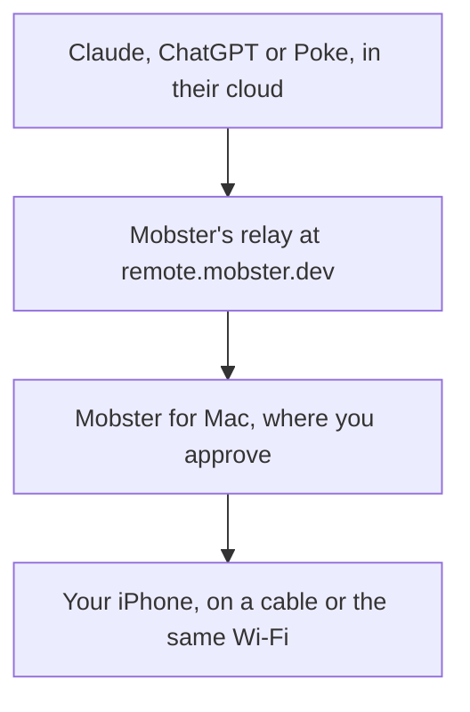

Mobster Remote lets Claude, ChatGPT, Poke and other assistants that run in the cloud start tasks on your iPhone while you're away from your Mac.

Your Mac dials out to Mobster's relay and keeps one connection open, so there's no port to open and no router to set up. An assistant's call reaches the relay, the relay passes it to Mobster for Mac, and Mobster runs the task on your iPhone as if you'd typed it. An assistant on the same Mac doesn't need Remote: it uses Mobster's local MCP server ([Add Mobster to your agent](/agents)).



## What you need

| You need | Why |
|---|---|
| Mobster for Mac, open, on a Mac that's awake and online | The assistant reaches your iPhone through it. `mobster serve` has no Remote |
| A Mobster plan on the account Mobster for Mac uses | Every plan includes Remote, with no second sign-in ([Your Mobster account](/account)) |
| The iPhone on a cable to that Mac, or on the same Wi-Fi ([Without the cable](/wifi)) | That's how Mobster reaches the phone, at home or away |
| The iPhone unlocked | A task on a locked iPhone waits 2 minutes for you to unlock it. Mobster never unlocks it |

Assistants hand over whole tasks in plain words. They can't tap, type or swipe, they never get a picture of the screen, and they can't approve anything. The iPhone stays with the Mac: Remote can't reach a phone on cellular.

## Turn it on

In Mobster for Mac, open Settings (⌘,), then **Remote**, and choose **Turn on**. Mobster registers this Mac with your account in about a second and opens no browser. The **Mobster Remote** row says "Connecting to Mobster Remote", then "On. Apps you allow can use your iPhone through this Mac."

Under it are the **Remote URL**, with **Copy**, and **Keep this Mac awake**, which is on by default. Remote is on for one Mac at a time: moving Mobster to another Mac turns it off on the Mac it leaves ([One Mac at a time](/account#one-mac-at-a-time)). If it doesn't turn on, the line under the switch says why ([In Mobster for Mac](#in-mobster-for-mac)).

## Connect an app

Every assistant uses the same URL. It isn't a secret: what keeps your iPhone safe is that you sign in, then allow the app on your Mac.

```text
https://remote.mobster.dev/mcp
```

<Steps>
  <Step title="Add the URL to your assistant">
    Add it where the assistant takes an MCP server or a custom connector. [Assistants](/remote/assistants) shows the place in Claude, ChatGPT, Poke, Raycast, Grok and the APIs.
  </Step>
  <Step title="Sign in">
    The assistant opens "Connect Claude to Mobster" (with its own name) in your browser. Sign in with the account Mobster for Mac uses: **Continue with Apple**, **Continue with Google**, **Continue with GitHub**, or your email and the 6-digit code Mobster sends, which works for 10 minutes. If you signed in there in the last 15 minutes, **Continue as sam@example.com** skips this.
  </Step>
  <Step title="Choose the iPhone">
    With more than one iPhone, the page asks "Which iPhone should Claude use?" and shows each one with its Mac and its state. A phone that's busy, locked or unplugged can still be chosen. Choose it, then **Use Sam's iPhone**. With one iPhone, this step is skipped.
  </Step>
  <Step title="Allow it on your Mac">
    The browser says "Mobster is asking on Sam's MacBook Pro. Choose Allow there to finish." Mobster on that Mac asks "Allow Claude to use Sam's iPhone?" Choose **Allow**. The browser says "Connected. Taking you back to Claude."
  </Step>
</Steps>

The app is now in Settings › Remote › **Connected apps**. Ask it for a task that only reads, such as "What's on my calendar tomorrow?", and the task shows in Mobster's sidebar, starting "Claude started this conversation through Mobster Remote."

### What Mobster asks on your Mac

The request appears over whatever Mobster is showing. When the window isn't in front, a notification says "Claude wants to use Sam's iPhone", and Settings › Remote shows the request with **Review**.

| Line | What it tells you |
|---|---|
| “Allow Claude to use Sam's iPhone?” | Which app, and which iPhone it gets |
| A check and `claude.ai` | Where the request sends you back to, and that Mobster confirmed it belongs to the app. Claude, ChatGPT, Poke, Raycast, Grok, Le Chat, Perplexity and Gemini are recognized by their domains |
| “Mobster can't confirm who made this app” | The domain isn't one Mobster knows: “Allow it only if you added it yourself a moment ago.” |
| “A program on the computer you signed in from” | The app runs on a computer, such as Claude Code, not on a website |
| “Claude will be able to” | The three things it may do ([What apps can and can't do](#what-apps-can-and-cant-do)) |
| “Requested by sam@example.com at 2:14 PM.” | The account that signed in on the web page, and when |

- Only **Allow** in Mobster on your Mac finishes the connection. No web page, message or assistant can allow it. One account is the exception: Radish's review account, which directory reviewers use, connects Claude and ChatGPT to a hosted demo with a scripted phone and invented data, so there is no Mac to choose Allow on ([The review account](/privacy#the-review-account)).
- **Allow** and **Don’t allow** do nothing for the first 0.7 seconds, so a stray click can't answer.
- Your Mac asks only after a click on Mobster's own page. Another site can't make your Mac show a request by sending you a link.
- The request waits 10 minutes, then ends: "This request ended. Connect again from Claude."
- An app that names itself after one Mobster knows but sends you elsewhere never reaches your Mac: the page says "This app isn't Claude" and stops.

## What apps can and can't do

Every app you allow gets the same three permissions, on the one iPhone you chose. You allow all of it or deny.

| Permission | On the Mac it reads | Tools |
|---|---|---|
| `tasks:run` | “Run tasks on Sam's iPhone” | `phone_task`, `phone_task_stop`, `run_workflow` |
| `tasks:read` | “See how its tasks went and what they found” | `phone_task_status`, `list_workflows`, `list_tasks` |
| `devices:read` | “See your iPhones' names and whether they're ready” | `list_devices`, `status` |

| Tool | Takes | Does |
|---|---|---|
| `phone_task` | `message` (1 to 4,000 characters); optionally `thread_id` (a follow-up), `device`, `wait_seconds` (0 to 25, default 20) | Hands a task to Mobster's agent and returns the answer, or how the task stands |
| `phone_task_status` | `thread_id` or `run_id`; optionally `wait_seconds` (0 to 25) | Running, waiting for you on your Mac, asking a question, or finished with its answer |
| `phone_task_stop` | `thread_id` or `run_id` | Stops the task at the next safe point |
| `list_devices` | nothing | The iPhone this app may use, with its state. Its id is opaque, never the UDID |
| `status` | nothing | One sentence, such as "Sam's iPhone is locked. Ask the user to unlock it." |
| `list_workflows` | nothing | Workflows with a webhook URL: id, name, steps and blanks |
| `run_workflow` | `workflow` (id or name), `values` (at most 300 characters each); optionally `wait_seconds` | Starts the workflow. It counts toward the daily task limit |
| `list_tasks` | optionally `limit` (1 to 25, default 10) | The tasks this app started, newest first |

Each call waits at most 25 seconds. A longer task keeps running, and the assistant follows it with `phone_task_status`. When Mobster accepts a task or a workflow but can't read how it stands, `phone_task` and `run_workflow` answer with status `status_unavailable` and the task's `thread_id` and `run_id`, so the assistant follows that task instead of starting another. A workflow of several steps answers with its `batch_id`, and you follow it in Mobster on your Mac. A follow-up with the same `thread_id` sees what the last task found. The workflow tools are for automation tools such as [Zapier](/zapier) ([Start a workflow from another tool](/webhooks#start-a-workflow-from-another-tool)).

An app can't:

- **Tap, type, swipe or open apps directly.** No tool or permission does that. The screen picture, notifications, the clipboard, files and installs aren't offered either.
- **Approve anything.** "Yes, send it" sent with `phone_task` approves nothing: the assistant is told the task waits for you.
- **Read or continue another app's conversation**, or use an iPhone other than the one you chose.
- **Open an app you turned off for agents outside Mobster** in Settings › Safety. An app Mobster hasn't used before asks first on your Mac.
- **Send files or read your [Memory](/memory).** Remote tasks get nothing from it.
- **Read out codes or passwords.** A remote task doesn't read notifications, and typing a one-time code into an app asks you first, like a send. Digits that look like a code are masked before an answer leaves your Mac.

## Approvals stay on your Mac

A task from a connected app always asks before it sends, buys, posts or deletes, even with Settings › Safety on **Full access**. The approval shows in Mobster on your Mac with the exact text ([Approvals and safety](/safety)). The assistant is told:

```text
It's waiting for the user to approve this in Mobster on their Mac: <what Mobster will do>. You can't approve it. Tell the user, then call phone_task_status.
```

- **Only the Mac app approves.** Approving needs a secret only the Mobster window holds, and the part of Mobster that talks to the relay never has it.
- **Never by email, SMS, iMessage, Slack or the assistant's own prompts.** An assistant that reads those channels could answer its own approval.
- **10 minutes.** An approval nobody answers ends the task without that action.
- **Questions are different.** The assistant can answer "Which Sam?" through `phone_task`. An answer never approves a send.
- **5 declines in a row pause the app.** Its row says **Paused**, with **Resume**.

Read-only tasks finish while you're away. To answer approvals away from home, reach the Mac with Screen Sharing over a private network such as Tailscale: Mobster works there as it does at home. macOS and Tailscale cover that setup in their own docs.

## Keep the Mac and the iPhone ready

**Keep this Mac awake** keeps the Mac from idle sleep with `caffeinate` while Remote is on. The display still turns off. A MacBook on battery with its lid closed still sleeps. `MOBSTER_KEEP_AWAKE=0` in the env file turns it off.

What works away from home is an iPhone that stays home, plugged into the Mac:

- **The iPhone:** on the cable, Auto-Lock **Never**, Low Power Mode off (it forces Auto-Lock to 30 seconds), low brightness.
- **Its battery:** on iPhone 15 and later, Settings › Battery › Charging › **80% Limit**.
- **Updates:** automatic iOS and macOS updates off. After a restart, the iPhone needs its passcode in person, and FileVault needs a login at the Mac before Screen Sharing works. Since iOS 18, an iPhone left locked for about 72 hours restarts itself.
- **The Mac:** on power, on a steady connection, with **Keep this Mac awake** on.
- **Which iPhone:** a second iPhone that stays home. If it's your only phone, it isn't in your pocket. Some apps allow one phone per account.

Apple's link between the Mac and the iPhone needs the cable or the same Wi-Fi, so a phone on cellular or on another Wi-Fi doesn't work.

<span id="remote-keys"></span>
## Connect with a Remote key

Some apps take a key instead of a sign-in: Poke, the xAI, OpenAI and Anthropic APIs, and your own scripts. Make one key per app.

<Steps>
  <Step title="Create the key">
    Settings › Remote › **Remote keys** › **Create key**. Give it a **Name** (1 to 40 characters), choose the **iPhone** if you have more than one, and choose when it **Expires**: 30 days, 90 days (the default) or 1 year.
  </Step>
  <Step title="Copy it now">
    The key starts with `mob_rk_`. "Mobster shows it only once": closing the dialog forgets it. Mobster and the relay keep only a hash.
  </Step>
  <Step title="Send it as a header">
    Send it as `Authorization: Bearer <key>`, never in a URL. A request with `?key=` or `?token=` is refused with "Send the key in the Authorization header."
  </Step>
</Steps>

To check a key, list its tools. The answer is a JSON-RPC result whose `result.tools` names the eight tools above:

```sh
curl -s https://remote.mobster.dev/mcp \
  -H "Authorization: Bearer $MOBSTER_REMOTE_KEY" \
  -H "Content-Type: application/json" \
  -H "Accept: application/json, text/event-stream" \
  -H "MCP-Protocol-Version: 2025-11-25" \
  -d '{"jsonrpc": "2.0", "id": 1, "method": "tools/list"}'
```

An expired key gets `401` with "This Mobster Remote key expired. Create a new one in Mobster, in Settings under Remote." A removed one gets "This Mobster Remote key was removed."

## Remove access

In Settings › Remote, choose **Remove** beside the app under **Connected apps**, or beside the key under **Remote keys**. The app can't use your iPhone after that, and the tasks it started stop. Your Mac refuses its next call, and the relay deletes its tokens within the same second when the Mac is online. To use the app again, connect it again.

Wider switches, each from Mobster on your Mac:

- **The Remote switch.** Off, no app reaches this Mac. Connected apps stay connected for when you turn it back on.
- **Move Mobster to another Mac**, or remove this Mac at mobster.dev/account. Every app connected through it loses access at once.
- **Sign out** in Settings › Account. The same, and your conversations stay on this Mac.

Disconnecting Mobster in the assistant removes the app too when the assistant tells Mobster. If it doesn't, remove it in Mobster as well.

## Limits

Per app, unless it says otherwise:

| Limit | Value |
|---|---|
| Tool calls | 20 a minute, in bursts of up to 5 |
| Tasks started with `phone_task` or `run_workflow` | 50 a day per app, 200 a day per Mac |
| Calls at once | 4 per app, 16 per Mac |
| One call | 30 seconds. `phone_task` and `phone_task_status` wait at most 25 |
| One request | 64 KB |
| One answer | 1 MiB |
| Requests waiting for you on a Mac | 3 |
| Declines in a row | 5 pause the app until you choose **Resume** |
| Macs per account | 3 |

The sign-in and connect pages limit each network:

| Limit | Value |
|---|---|
| App registrations | 2 a minute |
| Page loads | 30 a minute |
| Token requests | 60 a minute |
| Email codes, per address | 3 sent and 3 checked a minute, and at most one email a minute |

Past a limit, the page says "Too many tries", and an assistant gets `429` with how many seconds to wait.

## Privacy

The relay passes tasks along and doesn't keep them.

| What | Where it is |
|---|---|
| A task's text, its answer, any request or response | In the relay's memory on its way through. Never written to disk or logged |
| Apps you allowed: name, domain, permissions, phone, when connected and last used | On your Mac, and in the relay's record for your Mac, so it can route calls and refuse removed apps |
| Tokens and Remote keys | Hashes only, on the relay |
| Client approval links ([Ask your client first](/content-queue#ask-your-client-first)) | A hash of each link and when it ends, on the relay. The post and your client's answer pass through its memory only |
| Your phones | Names and states on the relay. Each phone's id is a hash made on your Mac, never its UDID |
| Your Profiles ([Console](/console)), on a Team plan with the control plane on | Each Profile's handle, its app and the phone it is on, on the relay. Never its notes, signature, links or variables |
| A team's usage counts ([Console](/console#usage)), on a Team plan with the control plane on | Per Mac, phone and day: runs finished, steps taken and saved-program replays, as numbers, for 30 days. No prices, task words or answers |
| A team's webhook endpoints ([Console](/console#webhooks)), on a Team plan with the control plane on | Each endpoint's address and signing secret, with the license service; the relay reads them to sign and send each post. A post holds ids, codes, fixed sentences and your Mac and phone names, never task words. The newest posts are listed for 7 days on the relay |
| Daily call counts | On the relay, for 30 days |
| Removed apps | A note that they were removed, on the relay, for 90 days |
| Requests to connect an app | On the relay, until a day after each one ends |
| The relay's logs | Route, status, duration, tool name, size and the first 6 characters of the app's id. Never bodies, emails, names, task text or answers |
| Your account | With Supabase: your email, how you sign in, your Macs and your plan. The relay reads it, writes nothing and keeps no Supabase token |
| The key your Mac connects with | In your Mac's Keychain. The relay keeps its hash |

Removing a Mac from your account deletes everything the relay holds for it.

- **Encryption ends at Cloudflare.** Calls are encrypted from the assistant to Cloudflare and from Cloudflare to your Mac. In between, the text is in Cloudflare's memory.
- **The assistant keeps what it gets,** under its maker's rules.
- **Who runs what.** Cloudflare runs the relay and the connect pages. Supabase runs the sign-in and sends code emails through Resend. [Privacy and your data](/privacy#mobster-remote) has the rest.

## Troubleshooting

### In the browser, while connecting

| You see | What to do |
|---|---|
| Sam's MacBook Pro is offline | Open Mobster on that Mac and keep it awake, then try again |
| Remote is off on Sam's MacBook Pro | Turn it on in Settings › Remote, then try again |
| Mobster Remote needs a Mobster plan | Choose a plan in Mobster on your Mac |
| No Mac uses Mobster Remote with this account | Sign in with the account Mobster uses (**Use another account**), and turn Remote on |
| No iPhone is set up on Sam's MacBook Pro | Set one up in Mobster on that Mac |
| This sign-in expired | The page was open over 15 minutes, or you started again in another tab. Connect again from the assistant |
| Nobody answered on your Mac | Nobody chose **Allow** or **Don’t allow** in 10 minutes. Try again at your Mac, or over Screen Sharing |
| Your Mac already has requests waiting | 3 requests wait. Answer them in Mobster first |
| Mobster can't connect to this app | The app's request is wrong, and the page says how. Tell the app's maker |
| This app isn't Claude | The app sends you somewhere else. Don't connect it, and remove the connector |
| Too many tries | Wait a minute, then try again |
| That code didn't work | Use the code in the newest email, or choose **Send a new code** |
| Something went wrong | Try again in a minute. If it keeps happening, write to support@radish.software |

When you choose **Don’t allow** on the Mac, or **Cancel** on the waiting page, the assistant hears `access_denied`.

### What the assistant tells you

The assistant gets these as tool errors and passes them on.

| It says | What to do |
|---|---|
| Sam's MacBook Pro is offline, so Mobster can't reach Sam's iPhone. Ask the user to open Mobster on that Mac and keep it awake. | Open Mobster on the Mac, and turn on **Keep this Mac awake** |
| Mobster Remote is off on Sam's MacBook Pro. The user can turn it on in Mobster, in Settings under Remote. | Turn on the switch in Settings › Remote |
| Mobster Remote needs an active Mobster plan on this account. The user can choose one in Mobster on their Mac. | Choose a plan ([Your Mobster account](/account#plans)) |
| Mobster on Sam's MacBook Pro didn't answer in time. The task may still be running: call phone_task_status. | The Mac took over 30 seconds. Ask the assistant to check the task |
| Mobster didn't confirm this task, so whether it started is unknown. Ask the user to check Mobster on their Mac before you start it again; don't start another to find out. | Look for the task in Mobster's sidebar. Ask for it again only if it isn't there |
| Mobster's helper on your iPhone is restarting. No action was taken. Try again in a moment. | Nothing started, and the conversation isn't kept. Ask again in a moment |
| Mobster didn't confirm this workflow run, so whether it started is unknown. Ask the user to check Mobster on their Mac before you start it again; don't start another to find out. | Look for the run on the workflow in Mobster. Ask for it again only if it isn't there |
| Mobster paused Claude's access after 5 declined approvals in a row. The user can resume it in Mobster, in Settings under Remote. | Read its conversations, then choose **Resume** in Settings › Remote if you want it back |
| Claude has started 50 tasks on this Mac today, the most Mobster allows in a day. Try again tomorrow. | Wait until tomorrow ([Limits](#limits)) |
| Too many calls. Wait a few seconds, then try again. | Nothing: the assistant waits |
| That conversation wasn't started by Claude, so Claude can't read or continue it. | Ask for a new task |
| Claude may use only Sam's iPhone. | Remove the app, connect it again and choose the other iPhone |
| It's waiting for the user to approve this in Mobster on their Mac: \<what Mobster will do>. You can't approve it. Tell the user, then call phone_task_status. | Answer the approval in Mobster on your Mac |
| Mobster Remote is paused for maintenance. Try again later. | Try again later |

An assistant that must sign in again got a `401`: you removed it, or its Remote key expired or was removed. Connect it again, or make a new key. An app registered more than 180 days ago registers again by itself ([how long Remote's credentials last](/security#how-long-remotes-credentials-last)).

### In Mobster for Mac

| Settings › Remote says | What to do |
|---|---|
| Can't reach Mobster Remote. Check this Mac's internet connection. Mobster keeps trying. | Check the connection. **Retry** tries now |
| Off. Connected apps can't reach this Mac until you turn Remote on. | Turn the switch on |
| Off. Remote needs a Mobster plan. Choose one in Settings › Billing. | Choose a plan ([Your Mobster account](/account#plans)) |
| This Mac left your account | It was removed on another Mac, or was offline over 90 days. Sign in, turn Remote on, then connect your apps again |
| This Mac isn't on your account any more. Sign in again in Settings under Account. | Sign in again |
| Mobster couldn't confirm your account. Try again in a minute. | Mobster checks again by itself. Try again in a minute |
| Mobster couldn't verify its server, so Remote didn't turn on. | Another app or this network may intercept secure connections. Try another network, or update Mobster |
| Mobster Remote isn't open yet. Check back soon. | The relay doesn't answer yet. Settings says "Not open yet. Check back soon." in place of **Turn on** |
| Remote didn't turn on. Try again. | Try again. If it keeps happening, write to support@radish.software |
| Update Mobster to use Remote | This version can't talk to Mobster Remote. Choose **Update** |
| Mobster Remote is part of Mobster for Mac. | You're in a browser on `mobster serve`. Use Mobster for Mac |
| Remote is on in another Mobster on this Mac | Two copies of Mobster run on this Mac. Quit one |
| Remote didn’t load | “Check that Mobster is running, then try again.” Choose **Retry**, or reopen Mobster |

## Next

<CardGroup cols={3}>
  <Card title="Assistants" icon="sparkles" href="/remote/assistants">
    Where to add Mobster in Claude, ChatGPT, Poke and the APIs.
  </Card>
  <Card title="Approvals and safety" icon="shield-check" href="/safety">
    Permission modes, and what waits for your OK.
  </Card>
  <Card title="Without the cable" icon="wifi" href="/wifi">
    Keep the iPhone on the Mac's Wi-Fi instead of a cable.
  </Card>
</CardGroup>
